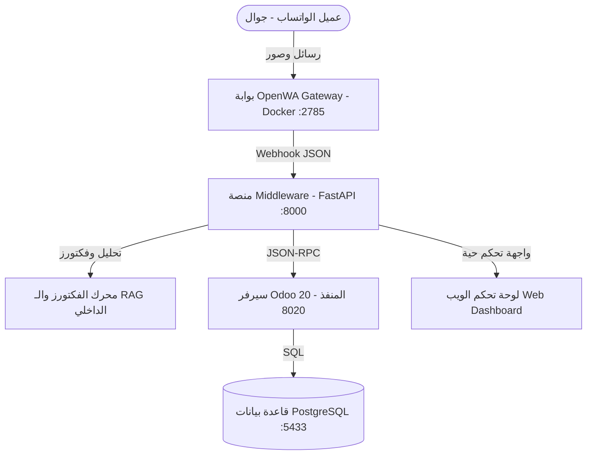

# دليل التشغيل الفني والتثبيت والربط الشامل (Developer Setup & API Guide)
## لمنظومة LINK SaaS الذكية والربط مع الواتساب و Odoo 20

---

## 1. المعمارية الفنية للنظام (System Architecture)

تتكون المنظومة من 4 طبقات متكاملة تعمل بتزامن لحظي لتقديم تجربة خدمة عملاء آلية ذكية:



### المكونات الأساسية:
1. **Odoo 20 Multi-Tenant Backend (`custom_addons/link_core`)**:
   - إدارة ملفات المستأجرين والتجار (`link.tenant`).
   - كتالوج الخدمات والباقات والمنتجات (`link.service.catalog`).
   - الشروط والمستندات الإلزامية والخصائص (`link.service.attribute`, `link.service.requirement`).
   - دورة حياة ومسار طلبات العملاء والحجوزات (`link.service.request`).
   - نقاط اتصال JSON-RPC RESTful APIs آمنة للتوجيه وتحديث الطلبات.
2. **FastAPI Middleware Platform (`middleware/`)**:
   - استقبال أحداث Webhook لحظية من الواتساب عبر OpenWA.
   - إدارة جلسات الدردشة والذاكرة المؤقتة.
   - رفع وتخزين المستندات والصور تلقائياً وربطها بالطلب المفتوح.
   - تقديم واجهة لوحة تحكم تفاعلية متميزة (`/static/index.html`).
3. **محرك الفكتورز والـ RAG (`middleware/rag_engine.py`)**:
   - تقسيم وفهرسة مستندات المتجر وقواعد المعرفة إلى فكتورز عالية الأبعاد (1024-D).
   - خوارزمية Cosine Similarity مع معالجة صرفية للجذور العربية (Arabic Light Stemming).
   - تتبع لحظي لحالة العميل وطلباته النشطة والإجابة الفورية لأسئلة ("وين قد طلبي").
4. **بوابة الواتساب المفتوحة OpenWA Gateway (`whatsapp_gateway/`)**:
   - تعمل داخل حاوية Docker معزولة ومستقرة.
   - إدارة جلسات WhatsApp Web الرسمية عبر مكتبة Puppeteer.

---

## 2. متطلبات النظام الأساسية (System Requirements)

- **نظام التشغيل:** Linux (Ubuntu 22.04 / 24.04 LTS أو Debian 12 موصى به).
- **Python:** إصدار Python 3.11 أو 3.12.
- **قاعدة البيانات:** PostgreSQL 15 أو 16.
- **Docker & Docker Compose:** لتشغيل بوابة واتساب OpenWA.
- **Node.js & npm:** (اختياري في حال رغبت ببناء OpenWA محلياً بدون دوكر).

---

## 3. التثبيت والإعداد خطوة بخطوة من الصفر

### الخطوة 1: تثبيت حزم النظام وتجهيز البيئة
```bash
sudo apt update && sudo apt install -y \
    git curl wget docker.io docker-compose-v2 \
    python3 python3-pip python3-venv \
    libpq-dev libxml2-dev libxslt1-dev libldap2-dev libsasl2-dev \
    libjpeg-dev zlib1g-dev libffi-dev build-essential
```

### الخطوة 2: إعداد قاعدة بيانات PostgreSQL
```bash
# إنشاء المستخدم وقاعدة البيانات بصلاحيات كاملة
sudo -u postgres psql -c "CREATE USER esam_odoo20 WITH PASSWORD '123' SUPERUSER CREATEDB;"
sudo -u postgres psql -c "CREATE DATABASE odoo20 OWNER esam_odoo20;"
```
> **ملاحظة:** تأكد من أن المنفذ هو الافتراضي `5432` أو `5433` وفقاً لما تم ضبطه في ملف `odoo.conf`.

### الخطوة 3: إنشاء البيئة الافتراضية وتثبيت مكتبات بايثون
```bash
# إنشاء البيئة الافتراضية
python3 -m venv /home/esam/PycharmProjects/odoo20/.venv
source /home/esam/PycharmProjects/odoo20/.venv/bin/activate

# ترقية مدير الحزم pip وتثبيت المتطلبات
pip install --upgrade pip
pip install -r link_platform/requirements.txt
```

---

## 4. كيفية تشغيل بوابة واتساب OpenWA والحصول على الـ API Keys

### أ) تشغيل حاوية OpenWA عبر Docker
```bash
docker run -d \
  --name openwa-api \
  --restart always \
  -p 2785:2785 \
  -v openwa_data:/app/data \
  -e PORT=2785 \
  -e WA_POPUP=false \
  openwa-openwa-api:latest
```
أو عبر `docker-compose`:
```bash
cd link_platform/whatsapp_gateway
docker compose up -d
```
للتأكد من صحة التشغيل:
افتح في المتصفح: `http://localhost:2785/api-docs` ستظهر لك واجهة Swagger الرسمية للبوابة.

---

### ب) خطوات ربط الواتساب ومسح الـ QR Code والحصول على الـ API Keys

#### 1. بدء جلسة واتساب جديدة (Start Session):
أرسل طلب POST لإنشاء جلسة جديدة (الاسم الافتراضي في المنظومة هو `2cdac89c-91c1-4a1d-b1de-b2bcf729fb7a` أو أي اسم جلسة تختاره):
```bash
curl -X POST "http://localhost:2785/api/sessions/2cdac89c-91c1-4a1d-b1de-b2bcf729fb7a/start" \
     -H "Content-Type: application/json"
```

#### 2. الحصول على كود الـ QR ومسحه بالجوال:
يمكنك الحصول على كود الـ QR بعدة طرق:
* **عبر المتصفح مباشرة:** افتح الرابط:
  `http://localhost:2785/api/sessions/2cdac89c-91c1-4a1d-b1de-b2bcf729fb7a/qr`
  سيظهر لك رمز الاستجابة السريعة QR Code كصورة مباشرة على الشاشة.
* **عبر سطر الأوامر:**
  افتح تطبيق واتساب في هاتفك -> **الأجهزة المرتبطة (Linked Devices)** -> **ربط جهاز** -> امسح الرمز الظاهر أمامك.

#### 3. التأكد من اتصال الجلسة وحالتها:
```bash
curl -X GET "http://localhost:2785/api/sessions/2cdac89c-91c1-4a1d-b1de-b2bcf729fb7a/status"
```
الرد المتوقع:
```json
{
  "status": "CONNECTED",
  "state": "READY",
  "phone": "9665XXXXXXXX"
}
```

---

### ج) ضبط الـ Webhook لتوجيه الرسائل إلى Middleware

لكي تصل كل رسالة وصورة واردة من واتساب إلى نظامنا المعالج، يتم تسجيل عنوان الـ Webhook للبوابة بالأمر التالي:
```bash
curl -X POST "http://localhost:2785/api/sessions/2cdac89c-91c1-4a1d-b1de-b2bcf729fb7a/webhooks" \
     -H "Content-Type: application/json" \
     -d '{
       "url": "http://127.0.0.1:8000/webhook/openwa",
       "events": ["message.received", "message"]
     }'
```

---

## 5. تشغيل Odoo 20 وتفعيل موديول `link_core`

1. تأكد من أن ملف `odoo.conf` يحتوي على مسار الموديولات:
```ini
[options]
addons_path = /home/esam/PycharmProjects/odoo20/odoo20/odoo-20/addons,/home/esam/PycharmProjects/odoo20/odoo20/odoo-20/custom_addons
db_host = 127.0.0.1
db_port = 5433
db_user = esam_odoo20
db_password = 123
db_name = odoo20
http_port = 8020
```

2. تشغيل Odoo وتثبيت الموديول:
```bash
/home/esam/PycharmProjects/odoo20/.venv/bin/python3 odoo-bin -c odoo.conf -d odoo20 -u link_core
```
افتح المتصفح على `http://localhost:8020` وسجل الدخول بحساب المشرف، وستجد قائمة **LINK SaaS Platform** مضافة في القائمة العلوية.

---

## 6. تشغيل منصة Middleware ومحرك الـ RAG

تشغيل خادم FastAPI:
```bash
/home/esam/PycharmProjects/odoo20/.venv/bin/uvicorn middleware.main:app --host 0.0.0.0 --port 8000 --reload
```
الروابط النشطة:
* **لوحة التحكم والمحادثة التفاعلية:** `http://localhost:8000/`
* **فحص صحة النظام:** `http://localhost:8000/api/health`
* **واجهة التوثيق التفاعلية (Swagger API):** `http://localhost:8000/docs`

---

## 7. سكربت التشغيل السريع الموحد (All-in-One Runner)

لتشغيل كامل المنظومة بضغطة زر واحدة:
```bash
bash link_platform/scripts/start_all.sh
```
ولإيقاف الخدمات:
```bash
bash link_platform/scripts/stop_all.sh
```

---

## 8. توثيق الـ APIs الرئيسية (Endpoints Reference)

### 1. استقبال رسائل واتساب (`POST /webhook/openwa`)
يستقبل أحداث الرسائل الواردة والصور تلقائياً من OpenWA.
```json
{
  "event": "message.received",
  "session": "2cdac89c-91c1-4a1d-b1de-b2bcf729fb7a",
  "data": {
    "from": "966501234567@c.us",
    "body": "وين قد طلبي",
    "pushName": "محمد السالم",
    "type": "text"
  }
}
```

### 2. محاكاة الرسائل وإرسال استفسار عبر المتصفح (`POST /api/chat/message`)
```bash
curl -X POST "http://127.0.0.1:8000/api/chat/message" \
     -H "Content-Type: application/json" \
     -d '{
       "phone": "+966509900112",
       "name": "عبدالله القحطاني",
       "text": "بكم بكج البوسنة وهل عندكم سيارة خاصة؟",
       "tenant_id": 1
     }'
```

### 3. رفع صورة مستند أو سند دفع (`POST /api/chat/upload_document`)
```bash
curl -X POST "http://127.0.0.1:8000/api/chat/upload_document?phone=%2B966509900112&doc_name=passport_copy"
```

### 4. استرجاع سجل المحادثة الكامل للعميل (`GET /api/chat/history?phone=966501234567`)
يعيد قائمة الرسائل المتبادلة بين العميل والبوت بالترتيب الزمني.

---

## 9. استكشاف الأخطاء الشائعة وحلها (Troubleshooting)

| المشكلة | السبب المحتمل | الحل |
| :--- | :--- | :--- |
| **بوابة واتساب غير متصلة (Session Inactive)** | انتهت صلاحية الجلسة أو تم تسجيل الخروج من الجوال | افتح رابط الـ QR `http://localhost:2785/api/sessions/{session_id}/qr` وامسح الرمز مجدداً. |
| **خطأ اتصال بقاعدة البيانات (Connection Refused 5433)** | خادم PostgreSQL متوقف أو المنفذ مختلف | تحقق عبر `sudo systemctl status postgresql` وتأكد من المنفذ في `odoo.conf`. |
| **الرسائل لا تصل للبوت عبر واتساب** | لم يتم تسجيل رابط الـ Webhook في OpenWA | نفذ أمر تسجيل الـ Webhook في الخطوة (4-ج). |
| **البوت يرد برسالة ترحيب مكررة** | المحادثة تعتبر جديدة لعدم حفظ الذاكرة | تأكد من عمل `middleware/main.py` والـ RAG Engine حيث يتم حفظ سجل آخر 8 رسائل لكل عميل. |
